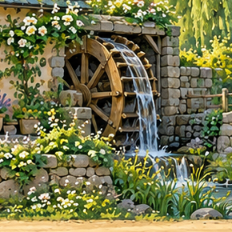
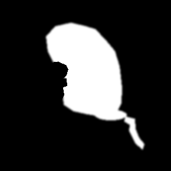
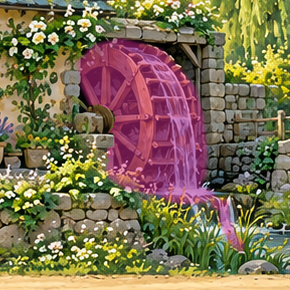

# 风铃溪谷案例：采用参数与验证边界

[制作手册](handbook.md) · [完整制作提示词](https://github.com/yuanyang749/windbell-valley/blob/main/PROMPT.md) · [在线成品](https://yuanyang749.github.io/windbell-valley/?v=wheel-sound-20261012)

本案例来自 2026-10-12 完成的版本。这些是观察到的结果，不是对任意新项目的默认值或成功率承诺。

## 1. 交付形式与来源

| 部分 | 实际实现 |
| --- | --- |
| 大地图 | 三个街区，单区 2172 × 724，相邻重叠 96 像素；合成 6324 × 724 |
| 网页 | 预渲染视频＋可拖动的静态全景 PNG |
| 完整视频 | 42 秒，1280 × 720，30 fps，共 1260 帧 |
| 静态美术 | Codex 内置图像生成；包括地图、角色基础图、独立效果参考 |
| 动作视频 | Grok 订阅登录，报告 `auth_source: grok-login`，模型 `grok-imagine-video-1.5` |
| 后处理 | `sprite-gen 2.42.0`、FFmpeg、本地 RIFE v4.6；项目作者绘制局部遮罩 |
| 落叶 | 生成的透明叶片，程序曲线路径、旋转和淡化，48 fps 采样，不使用 RIFE |
| 音乐 | 原创 16 小节、72 BPM、3/4 拍；macOS General MIDI 乐器本地渲染 |
| 环境声 | Grok 带音频短片抽取的生成环境声；本地距离包络、声场和混音，少量本地合成风铃 |

人物和 NPC 的**基础图**与其**动作视频**有不同来源，不能统一写成全部由 Grok 绘制。来源以实际生成记录为准。

## 2. 主要制作阶段

1. 根据统一风格、道路高度和接缝要求生成三个街区并合成地图。
2. 生成人物和独立透明装饰；主角和白狐分别制作走路、跑步动作。
3. 修正老人站位到桥面，并增加原图近侧石栏遮挡。
4. 将三个静态 NPC 改为挥手、浇花、吹笛摇头与音符循环。
5. 完成原创音乐、网页与静态地图发布。
6. 逐步加入晾衣、柳树、溪流、三角旗、喷泉、大树、烟雾和昆虫。
7. 先完成水车水流，再加入轮体转动；扩展固定轴心支撑和石块遮罩。
8. 为大树、喷泉、溪流和水车加入随游览位置变化的环境声。
9. 新产物验证后替换成品，检查本地交互及 GitHub Pages 部署。

各阶段保留了已工作的场景，未重生成既有地图或人物。

## 3. 角色、位置与周期

老人最终世界位置 `[5490,417]`、比例 `0.82`；人物层 z=10，桥前侧石栏 z=11。桥遮挡从原图 `[5370,384,5620,494)` 提取。新地图必须重新判断支撑面和遮挡。

三个 NPC 的采用循环各为 64 帧、4 秒；RIFE 重采样为 128 帧、4 秒，即素材采样 32 fps。源视频的 fps、选周期/缩放后帧数和最终视频 fps 是不同概念。

| NPC | 实际有效 RIFE 中间帧 | 拒绝提案 | 最终帧数 |
| --- | ---: | ---: | ---: |
| 园丁 | 59 | 5 | 128 |
| 面包师 | 63 | 1 | 128 |
| 吹笛老人 | 64 | 0 | 128 |

主角和白狐使用各自经过检查的周期，不套用 NPC 的时间规则。

## 4. 环境裁剪坐标

这些坐标绑定当前地图，单位为原图像素，右/下边界不包含：

| 对象 | 采用裁剪框 | 周期 |
| --- | --- | ---: |
| 晾衣 | `[1200,300,1560,540)` | 4 秒 |
| 柳树 | `[5040,45,5552,429)` | 4 秒 |
| 河流 | `[5020,248,5724,644)` | 4 秒 |
| 三角旗 | `[2890,280,3250,390)` | 4 秒 |
| 喷泉 | `[3020,360,3200,515)` | 4 秒 |
| 大树 | `[3010,0,3800,380)` | 4 秒 |
| 水车转动＋流水 | `[4960,305,5250,595)` | 8 秒 |

大部分不透明环境循环采用 96 帧、24 fps 的源周期，输出 192 帧、48 fps；水车转动采用 192→384 帧，仍为 8 秒。昆虫有 6 个 RIFE 提案被拒绝；程序落叶不是视频补帧。

柳树和旗帜采用第二版视频。当前水车原片 `clip-retry.mp4` 的重提来自网络失败，不能把文件名当作“第一次画面不合格”的证据。

## 5. 水车遮罩与实际检查

轮体、水帘和下游细流显示生成动画，前侧固定轴心支撑及石块取原图。插帧后重新应用同一遮罩。

| 检查项 | 记录结果 |
| --- | --- |
| 输入/输出 | 192/384 帧，24/48 fps，8 秒 |
| 有效 RIFE 提案 | 192 个保留 |
| 轴心局部保护 ROI | `[91,110,108,126)` |
| 前景石块保护 ROI | `[92,136,107,145)` |
| 固定 ROI | 所有输出帧与原图像素相同 |
| 遮罩外 | 合回地图后保持原像素 |
| 普通相邻帧 MAE 中位数 | 5.058 |
| 末→首接缝 MAE | 9.242 |
| 接缝/普通相邻比值 | 1.827 |
| 目视 | 八个原始相位和轮辐运动特写，检查透视、可见转动与遮挡 |

最初保护区不足导致轴心 ROI 检查失败，扩展排除区后重新生成后处理产物并通过检查。这些 MAE 数字是该遮罩/素材下的记录，不能直接作为新素材的通用合格阈值。

没有量测“8 秒恰好旋转 360°”，也没有保证所有生成木纹/轮辐达到机械建模的精度。刚性要求来自提示词，采用判定来自实际检查，两者不能混淆。

## 6. 环境声音

三条 Grok 生成音轨：轻风叶响、喷泉细水、溪流＋淡木轮声。每条约 6 秒，经剪边和 0.35 秒交叉淡化循环，再与原创音乐混音。

| 声源 | 世界 x | 案例中的可听区间（增益大于 5%） |
| --- | ---: | --- |
| 山坡微风 | 1160 | 0.22–10.43 秒 |
| 大树叶响 | 3340 | 16.31–29.15 秒 |
| 集市喷泉 | 3130 | 16.85–25.12 秒 |
| 水车溪流 | 5140 | 31.44–41.69 秒 |

按预设主角位置计算平滑距离衰减与左右声场；这些时间点只适用于本片镜头。游戏应改用实时位置。

最终声音为 42 秒、立体声；本地 WAV 主峰值约 −8.894 dBFS，未削波。环境音为生成的自然录音风格，不宣称现场实录。

## 7. 验证与公开内容

成片完整解码通过：H.264，1280 × 720，30 fps，1260 帧，42 秒；AAC 立体声 48 kHz。浏览器检查播放、声音开关、树/水车时间跳转。公开视频服务返回 `206 Partial Content`，线上文件与发布版本核对一致。

公开网页主要包含最终 MP4、封面、全景 PNG、页面和制作说明。原始 Grok 视频、大量 PNG 帧、完整工作目录与 macOS 声库没有随本技能包分发。技能包的三张示意图来自已公开地图的对应裁剪及作者制作的遮罩。

## 8. 下一项目可以与不可以直接复用的内容

- 可复用：制作决策、提示词结构、锚点/时长合同、遮罩方法、质量检查、工具配方、素材与公开目录分离。
- 重新确定：地图位置、裁剪框、遮罩轮廓、人物比例、周期、帧率、精确转速、声源半径、镜头和运行时导入方式。
- 待具体项目验证：图集与游戏引擎接入、输入状态、实时环境声、目标设备资源预算。
